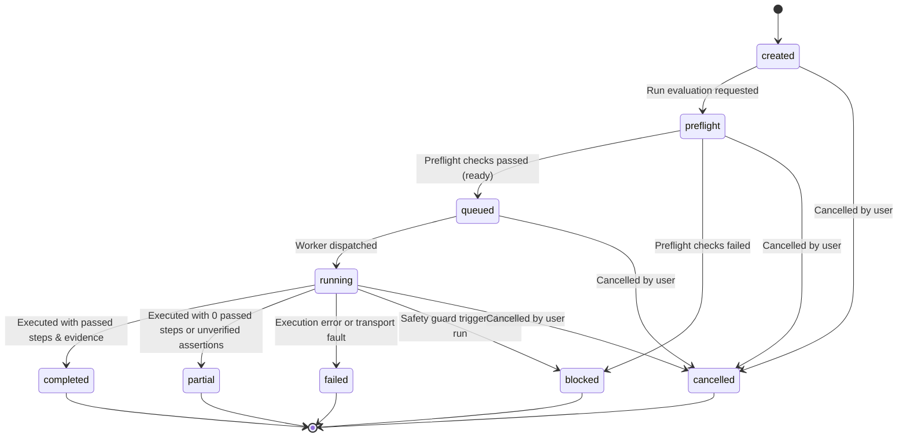

# CrashLab Hosted MVP Architecture

**Build 11: Hosted MVP Architecture and Productization Foundation**

This document describes the architectural transition of CrashLab from a local CLI-first testing harness into a secure, multi-tenant private-beta SaaS platform.

---

## 1. Executive Summary

CrashLab's core value is autonomous, evidence-first software QA. Through Builds 1 to 10.5, CrashLab established deterministic journey planning, browser execution, anomaly classification, bounded reproduction, known-good baselines, append-only human review triage, preflight safety gates, and local product demos.

**Build 11 establishes the architectural and domain foundation for hosting CrashLab as a multi-tenant cloud service.**

```text
User
  │
  ▼
Workspace (Tenant Boundary)
  │
  ▼
Project (Application Under Test)
  │
  ▼
Target Environment (Authorized Staging / QA / Demo / Local)
  │
  ▼
Approved Journeys (Pre-authorized intent paths)
  │
  ▼
Preflight Validation Safety Gate (Deterministic check)
  │
  ▼
Test Run (Lifecycle State Machine)
  │
  ▼
Browser Worker (Isolated execution context)
  │
  ▼
Evidence Reports (Scout, Journey, Execution, Anomalies, Reproduction)
  │
  ▼
Candidate Review (Human operator triage & event store)
```

---

## 2. Current Local Architecture vs Future Hosted Architecture

| Dimension | Current Local Harness (Builds 1–10.5) | Future Hosted Product (Build 11+ Target) |
| --- | --- | --- |
| **User Identity** | Local terminal operator | Authenticated User with multi-tenant workspaces |
| **Tenancy** | Single-user local filesystem | Workspace-level isolation with role-based permissions |
| **Storage** | Local `reports/` directory | Provider-neutral repositories (PostgreSQL + Object Storage) |
| **Secrets** | Local environment variables / local files | Secret provider interface with vaulted reference keys |
| **Execution** | Local in-process Playwright browser | Async browser worker pool with ephemeral sandboxes |
| **API** | Read-only local Review API (`localhost:3210`) | Product API (`/api/v1/*`) + Review API |
| **Safety Gate** | CLI `pilot-preflight` & `pilot` runner | Mandatory preflight gate before run queuing |
| **Invariants** | `safeTestMode: true`, `confirmed: false` | Strictly preserved across all hosted layers |

---

## 3. Product Architectural Boundaries

### 3.1 Tenant Boundary (Workspace)
- Every customer-owned entity (projects, targets, journeys, runs, artifacts, candidates, audit events) strictly belongs to a single `Workspace`.
- Cross-workspace queries are impossible: repository methods and service methods require `workspaceId` and enforce authorization checks before reading or writing any record.

### 3.2 Authentication & Authorization Boundary
- Authentication verifies user identity (`User`).
- Authorization verifies membership in the target workspace (`WorkspaceMember`) and enforces role permissions:
  - `owner`: full workspace management, project creation, target configuration, test execution, candidate review.
  - `member`: view projects, execute tests against approved targets, view reports.
  - `reviewer`: view reports, update human review triage state.
  - `viewer`: strictly read-only access across the workspace.
- Invariant: No role may bypass payment guards, preflight validation, origin restrictions, or confirmation invariants.

### 3.3 Secret Boundary
- Product configurations store **safe metadata and non-secret references only**:
  - Target URL, target origin, allowed origins, application build ID.
  - Non-secret authorization reference string (e.g. `REF-LEAD-SIGN-01`).
  - Test data reference key (e.g. `vault:testdata:qa-cart`).
- Configurations **never** store passwords, cookies, bearer tokens, API keys, or private keys.
- Secret values are resolved at runtime through the provider-neutral `SecretProvider` interface.

### 3.4 Browser Worker Boundary
- In the hosted architecture, browser execution does not run in the web API process.
- Runs transition through the `TestRun` lifecycle state machine:
  `created` → `preflight` → `queued` → `running` → `completed` / `partial` / `failed` / `blocked` / `cancelled`.
- Workers pull jobs only when preflight status is `ready` and safe test mode is confirmed.

### 3.5 Report Storage Boundary
- Raw evidence files (screenshots, JSON logs, HTML snapshots) are stored via `ReportStorageProvider`.
- Database records store metadata, SHA-256 hashes, byte sizes, and content types, keeping database rows compact and performant.

---

## 4. Run Lifecycle Model



### Transition Invariants
1. **Terminal Immutability:** Terminal states (`completed`, `partial`, `failed`, `blocked`, `cancelled`) can never transition to any other status.
2. **Preflight Gate:** A run cannot transition to `queued` or `running` unless preflight validation status is `ready`.
3. **Evidence Requirement:** A run cannot be marked `completed` without verifiable execution evidence and at least one passed step (preventing unexercised runs from claiming completion).
4. **Safe-Test Mode:** `safeTestMode` is permanently enabled on all runs; runs attempting to disable it are rejected.
5. **Audit Logging:** Every state transition emits an immutable `AuditEvent`.

---

## 5. What Build 11 Does and Does NOT Implement

### What Build 11 Implements:
- Strongly typed domain contracts under `src/product/types/`.
- Pure tenant authorization functions under `src/product/auth/`.
- Run lifecycle state machine under `src/product/lifecycle/`.
- Provider-neutral repository abstractions and in-memory test adapter under `src/product/repository/`.
- Preflight safety adapter connecting product entities to the established Build 10.2 safety validator.
- Secret sanitization and provider contracts under `src/product/secrets/`.
- Minimal product REST API with loopback server under `src/product/api/`.
- Rehearsal demonstration proving the complete tenant lifecycle without browser execution.
- Comprehensive database schema, security model, and API documentation.

### What Build 11 Does NOT Implement:
- **Build 11 does not deploy CrashLab to the cloud.**
- **Build 11 does not connect to a real database** (no PostgreSQL, Supabase, or MongoDB connections in tests).
- **Build 11 does not execute remote browser jobs** (no external worker queue or cloud browsers).
- **Build 11 does not run real staging tests** (real staging pilots remain blocked until written authorization is provided).
- **Build 11 does not process payments or add billing.**
- **Build 11 does not add AI models or LLM dependencies.**
- **The existing local demo (`npm run demo`) remains the reference implementation.**
